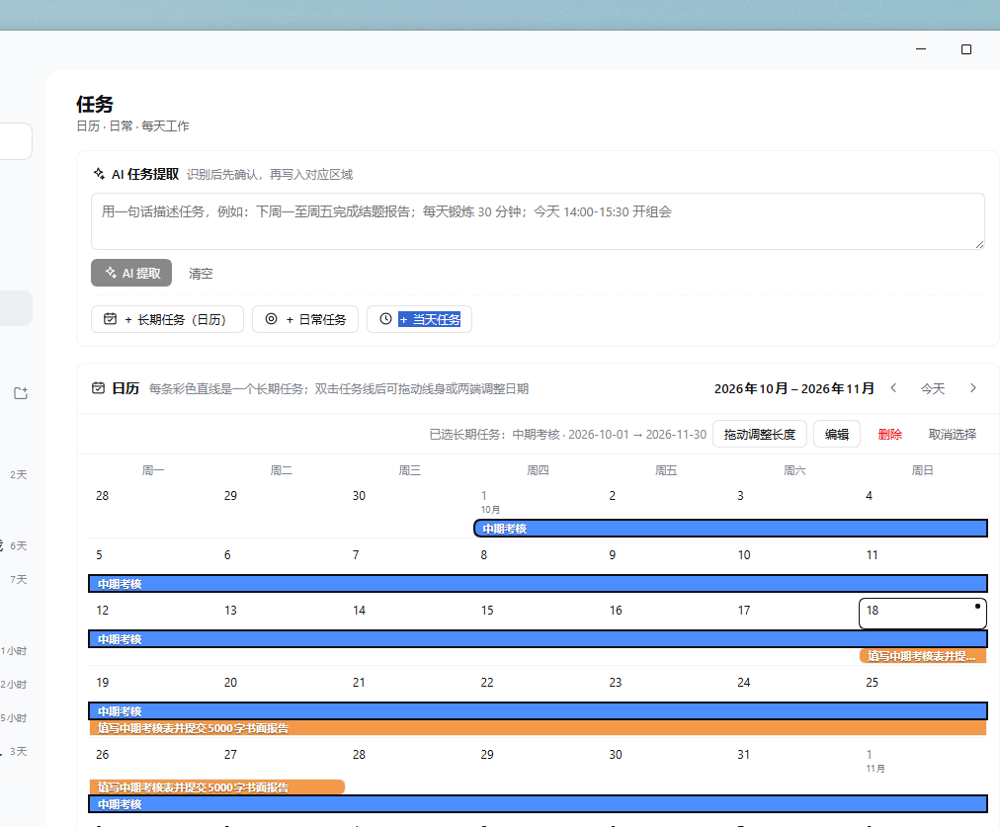
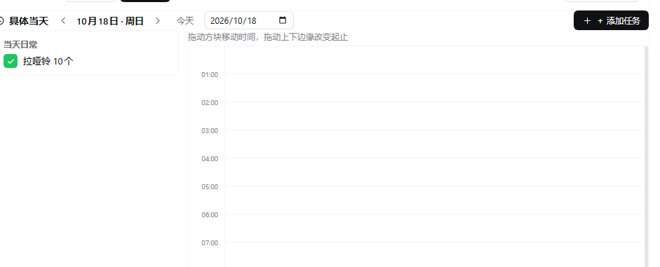
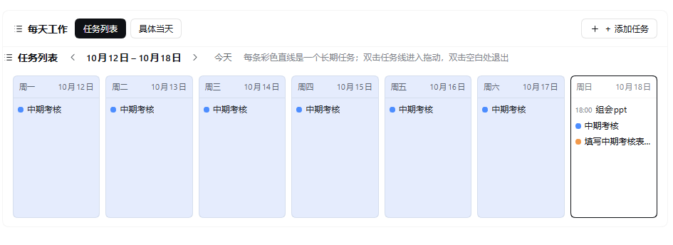

# dsh-task-board · 个人任务管理

DSH Web GUI 的个人任务管理面板：双月日历、日常清单、每天工作视图与可拖拽的 24 小时时间轴，并支持用自然语言让 AI 提取任务。





## 功能

- **双月日历**：连续两个月网格；每个长期任务按起止日期画成一条彩色时间条。跨周自动分段，每周行默认最多 5 条、超出可展开；双击线条进入拖动模式（拖线身移动日期、拖两端改长度）；已度过的日期段用浅灰雾面 + 细斜纹 + 白色毛玻璃描边标出。
- **日常任务**：每天重复的习惯清单，圆角方块勾选框（完成时绿色实心 + 白色对勾）；可增删改。
- **每天工作**：按钮切换两种视图。
  - **任务列表**：周一至周日 7 个竖列，左右翻页切换周；已过去日期背景为 `#E5ECFD`；只列非日常任务（定时任务与跨天长期任务），每行带完成勾选框。
  - **具体当天**：左侧「当天日常」与「当天任务」两个清单，右侧 24 小时纵向时间轴；方块可拖动移动、拖上下边缘改起止（15 分钟吸附），双击时间轴空白处快速新建；点方块可编辑。
- **AI 提取**：页面顶部输入一段中文安排（例如「下周一至周五完成结题报告；每天锻炼 30 分钟；今天 14:00-15:30 开组会」），点击提取后调用当前默认模型解析为可编辑的任务草案，确认后写入日历 / 日常清单 / 当天安排。模型不可用、超时或返回格式异常时自动降级为本地规则解析，并给出提示。
- **持久化**：改动自动保存到 `<DSH_HOME>/task-board/data.json`；写入前做字段校验与原子重命名，读取失败时暂停自动保存以免覆盖原文件。

## 安装

插件需要 DSH `>= 0.2.1-rc.2`。任选一种：

```sh
# 从 npm 安装（发布后可用）
dsh plugin --profile web add dsh-task-board

# 或直接从 GitHub 安装
dsh plugin --profile web add github:GinoXiang/dsh-task-board
```

安装后重启 DSH 或刷新 Web GUI，侧边栏会出现「任务」图标，点开即进入任务面板。

## 数据与权限

- 只读写 `<DSH_HOME>/task-board/data.json` 一个 JSON 文件（默认 `~/.dsh/task-board/data.json`）；卸载插件不会删除该文件。
- AI 提取只在点击「AI 提取」时调用一次当前配置的默认模型，不会后台自动请求；不发送文件内容，只发送输入框里的文本。
- Host 端提供三个本地 HTTP 接口（`/task-board/load`、`/task-board/save`、`/task-board/extract`），仅接受回环地址与同源请求，只支持 POST，请求体上限 2 MB。
- 无第三方运行时依赖；客户端使用 DSH Web GUI 自带的 React 与主题 token。

## 开发

```
index.js           Host 半：三个本地接口、JSON 存储、LLM 提取 + 本地降级解析
client.js          Client 半：侧边栏图标与整页 UI（plain JS，无需构建）
cordis.patch.yml   插件插入补丁
locale/en.json     插件显示名与描述（英文）
locale/zh.json     插件显示名与描述（中文）
icon.svg           插件图标
```

修改 `client.js` 或 `index.js` 后，在插件管理中禁用再启用该 bundle 即可让客户端半重新加载。

## License

MIT

---
---

# dsh-task-board · English

A personal task board for the DSH Web GUI: a two-month calendar, a daily checklist, week and day work views with a draggable 24-hour timeline, and AI extraction of tasks from natural language.

## Features

- **Two-month calendar** — every long-term task is drawn as a colored timeline bar across its date range; bars are split per week, each week row shows up to five lanes with an expand button, and double-clicking a bar enters drag mode (move the body, drag either end to resize). Days before today are rendered as a hazy gray band with fine diagonal hatching and a white glass-like outline.
- **Daily tasks** — recurring daily habits in a rounded-square checkbox list (green filled with a white check when done); add, rename and delete.
- **Daily work, two views** — a seven-column week list (Monday to Sunday, page between weeks, past days tinted `#E5ECFD`, completion checkboxes for timed tasks and long-term projects) and a specific-day view with the day's daily tasks, the day's tasks, and a 24-hour timeline whose blocks move by dragging and resize by dragging their edges (15-minute snapping, double-click empty space to add).
- **AI extraction** — paste a Chinese schedule into the top bar, click extract, review the editable task drafts, then confirm to write them into the calendar, the daily checklist or a day plan. When the default model is unavailable, times out, or returns malformed output, a local rule-based parser takes over with a notice.
- **Persistence** — autosave to `<DSH_HOME>/task-board/data.json` with validation and atomic writes; autosave pauses if the file cannot be read, so a corrupt file is never overwritten.

## Install

```sh
dsh plugin --profile web add dsh-task-board
# or
dsh plugin --profile web add github:GinoXiang/dsh-task-board
```

Requires DSH `>= 0.2.1-rc.2`. Restart DSH or refresh the Web GUI after installing; a "任务" (Tasks) icon appears in the sidebar.

## Data and permissions

- Reads and writes only `<DSH_HOME>/task-board/data.json` (default `~/.dsh/task-board/data.json`).
- The default model is called once per explicit AI-extract click; nothing is fetched in the background and no file content is sent.
- Three local HTTP endpoints (`/task-board/load`, `/task-board/save`, `/task-board/extract`) accept loopback, same-origin POST requests only, with a 2 MB body cap.
- No third-party runtime dependencies; the client uses the React instance and theme tokens provided by the DSH Web GUI.

## License

MIT
